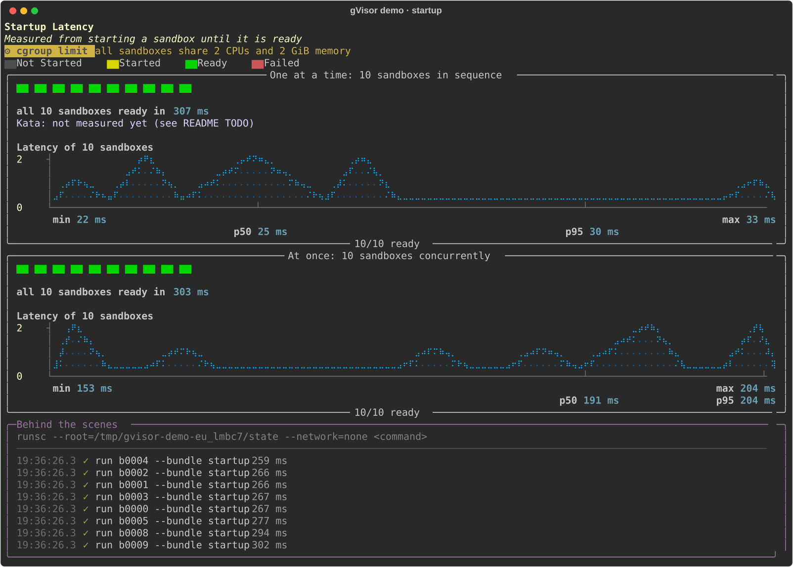
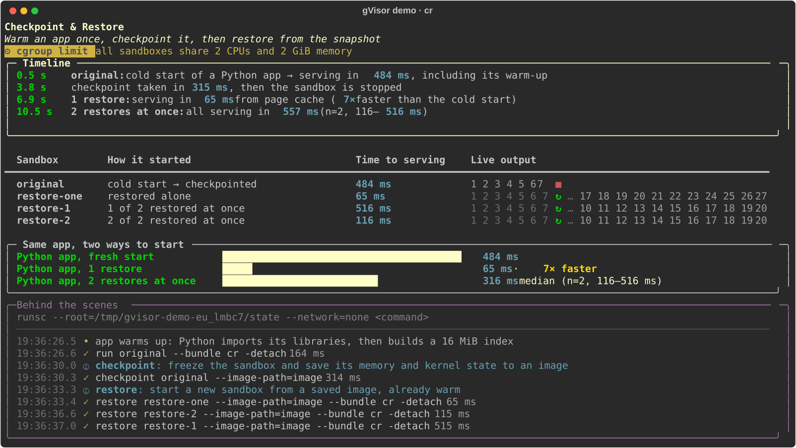

# Live demos

[TOC]

Run the [gVisor demos](https://github.com/milantracy/gvisor-demo) to see real
sandboxes start and restore from checkpoints on your machine. The demos run
locally in a terminal. You do not need a browser interface or a cloud account.

## Requirements

The initial supported environment is Ubuntu 24.04 on x86\_64, with root access
and a writable cgroup v2 hierarchy. Use a development machine or a disposable VM.
The quick profile needs neither Docker nor nested virtualization.

Install the complete gVisor distribution using the
[installation guide](install.md). Then install the demo dependencies:

```shell
sudo apt-get update
sudo apt-get install -y git python3 python3-rich busybox-static
```

Install Rich for the system Python because the demo runs with `sudo`.
Use a terminal of at least 110 columns and 45 lines.

## Run the quick demo

```shell
git clone https://github.com/milantracy/gvisor-demo.git
cd gvisor-demo
sudo python3 demo.py --check
sudo python3 demo.py
```

`--check` reports missing requirements without creating sandboxes. If `runsc`
is outside the default search path, pass its absolute path with `--runsc` to both
commands. Keep the gVisor distribution together when moving it.

The default `quick` profile runs the introduction, a platform check, startup,
checkpoint/restore, and a summary. It starts 10 sandboxes sequentially and 10
simultaneously, then checkpoints a 16 MiB application, restores it once, and restores two
additional copies concurrently.
It limits sandboxes to at most two CPUs and 2 GiB of memory, reduced to the
CPU affinity and host physical RAM. The Python interface itself is outside the
sandbox cgroup.

Press Enter to advance, `s` to skip a scene before it starts, `r` to repeat a
finished scene, and `q` to quit. Ctrl-C also stops the demo and cleans up its
sandboxes. For an unattended run and an explicit results path:

```shell
sudo python3 demo.py --auto 1 --output quick-results.json
```

The results file must not already exist. By default, the demo creates a unique
JSON file in the current directory, owned by the user who invoked `sudo`. It
saves partial results on failure or interruption, even without the summary
scene. The file records the runtime version, profile, platform selection, limits
and measured results.

## Scenes

| Scene | What it shows | Additional requirements |
| --- | --- | --- |
| `intro` | Introduction to the presentation. | None. |
| `anywhere` | Host platform checks and a sandbox reporting its kernel version. | None. |
| `startup` | Time until an application prints its first line, sequentially and concurrently. | None. |
| `cr` | A working application resuming from a checkpoint and multiple restored copies. | The host's Python installation is mounted read-only in the sandbox. |
| `summary` | Measurements from the scenes completed in this run. | None. |
| `churn` | Repeated sandbox creation and destruction. | Capacity for the selected concurrency. |
| `density` | Resource use as idle sandboxes accumulate. | Capacity for the selected sandbox count. |
| `systemd` | systemd as PID 1, followed by a terminal Chromium browser. | Docker, network access, and an x86\_64 Chromium image. |

Choose scenes explicitly to replace the default sequence:

```shell
sudo python3 demo.py startup cr summary --runs 5 --burst 5
```





These captures show example runs. Times and resource use depend on the machine,
runtime version, workload, and selected limits.

## Larger presentations

`--profile full` selects every scene and the original presentation settings:
200 sequential starts, 200 simultaneous starts, a 128 MiB application, one restore followed by 10 concurrent
restores, and up to 5,000 idle sandboxes, with limits of 16 CPUs and 32 GiB.
Explicit workload options override profile defaults.

Check requirements for the selected scenes before running them:

```shell
sudo python3 demo.py --profile full --check
sudo python3 demo.py --profile full
```

The systemd scene builds and caches its image on first use. It needs Docker and
network access for the build; the browser also needs access to YouTube. Its
sandbox uses the host network. The cache is separate from temporary run data.

The checkpoint scene normally restores from the page cache. `--cr-cold` runs
`sync` and drops the **host's** page cache before restoring. Use that option only
on a disposable machine. To run without cgroup limits, explicitly pass
`--no-limit`; this gives sandbox workloads access to the machine's available
resources.

These measurements are demonstrations, not a controlled benchmark comparison.
Any Kata figures displayed by the presentation are external reference values,
with their sources, rather than measurements made by this run.

## Troubleshooting

- **Missing cgroup controllers or a read-only hierarchy:** run on a host with
  writable cgroup v2 and the CPU, cpuset, memory and PIDs controllers
  enabled in the parent's `cgroup.subtree_control`. Running
  inside another container can restrict access. `--no-limit` explicitly disables
  demo resource limits.
- **Busybox does not run inside the sandbox:** install `busybox-static`, rather
  than a dynamically linked busybox executable.
- **An operation times out:** inspect the terminal error and the partial JSON
  results. Commands through the runsc wrapper and startup readiness waits have a
  60-second timeout; checkpoint application readiness waits use 30 seconds. Reduce concurrency or
  check the installed gVisor distribution before retrying.
- **An explicit work directory already exists:** choose a new path. The demo
  refuses to reuse a directory, follow symlink ancestors, or remove another
  run's files. The default creates a private directory under `/tmp`.
- **Titles render incorrectly:** use `--title-size normal`. Use `--activity off`
  to hide the command activity panel on a small terminal.

For all options, run `python3 demo.py --help` or see the
[demo README](https://github.com/milantracy/gvisor-demo#readme).
